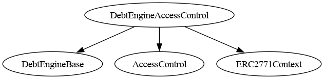
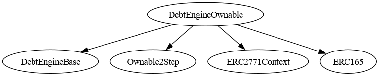
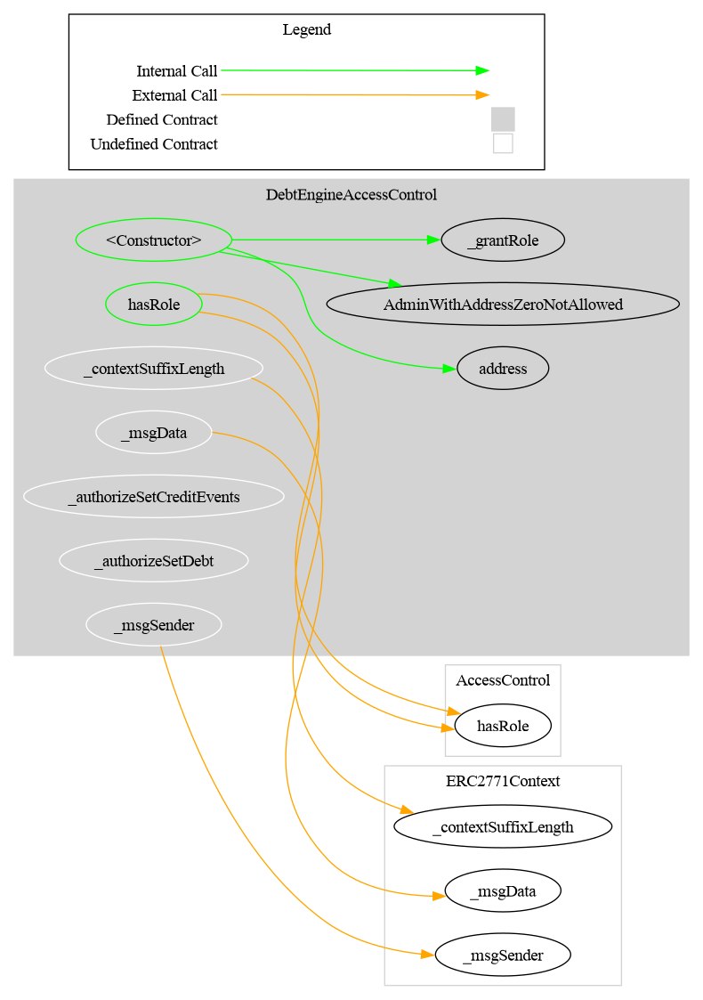
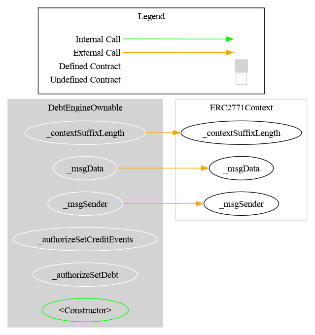

# Debt Engine

> This project has not been audited yet, please use at your own risk. For any questions, please contact [admin@cmta.ch](mailto:admin@cmta.ch).

This repository includes the DebtEngine contract for the [CMTAT](https://github.com/CMTA/CMTAT) token.

The DebtEngine allows defining `debt` and `credit events` for several different contracts.

## Data Structures

A `debt` is represented as a `DebtInformation` struct composed of two parts:

```solidity
struct DebtInformation {
    DebtIdentifier debtIdentifier;
    DebtInstrument debtInstrument;
}
```

**DebtIdentifier** — information on the issuer and other persons involved:

```solidity
struct DebtIdentifier {
    string issuerName;
    string issuerDescription;
    string guarantor;
    string debtHolder;
}
```

**DebtInstrument** — information on the instrument:

```solidity
struct DebtInstrument {
    uint256 interestRate;
    uint256 parValue;
    uint256 minimumDenomination;
    string issuanceDate;
    string maturityDate;
    string couponPaymentFrequency;
    string interestScheduleFormat;
    string interestPaymentDate;
    string dayCountConvention;
    string businessDayConvention;
    string currency;
    address currencyContract;
}
```

A `creditEvents` is defined with the following attributes:

```solidity
struct CreditEvents {
    bool flagDefault;
    bool flagRedeemed;
    string rating;
}
```

## Architecture

The DebtEngine uses a layered architecture:

- **`DebtEngineBase`** (abstract) — contains all business logic, mappings, events, and authorization hooks. Does not depend on any specific access control mechanism or meta-transaction standard.
- **Deployment contracts** — concrete contracts that wire in access control and ERC-2771 support:
  - **`DebtEngineAccessControl`** — uses OpenZeppelin `AccessControlEnumerable` (RBAC, role holders listable on-chain) with granular `DEBT_MANAGER_ROLE` and `CREDIT_EVENTS_MANAGER_ROLE`.
  - **`DebtEngineOwnable`** — uses OpenZeppelin `Ownable2Step` (single owner controls everything; two-step ownership transfer).

## Functions

| Function | Visibility | Access | Description |
| --- | --- | --- | --- |
| `debt()` | External | Public | Returns debt for the caller's contract |
| `debt(address)` | Public | Public | Returns debt for a specific contract |
| `creditEvents()` | External | Public | Returns credit events for the caller's contract |
| `creditEvents(address)` | Public | Public | Returns credit events for a specific contract |
| `hasDebt(address)` | External | Public | Returns true if debt has been explicitly set |
| `hasCreditEvents(address)` | External | Public | Returns true if credit events have been explicitly set |
| `setDebt(address, DebtInformation)` | External | Authorized | Set debt for a contract |
| `setCreditEvents(address, CreditEvents)` | External | Authorized | Set credit events for a contract |
| `setDebtBatch(address[], DebtInformation[])` | External | Authorized | Set debt for multiple contracts (max 500) |
| `setCreditEventsBatch(address[], CreditEvents[])` | External | Authorized | Set credit events for multiple contracts (max 500) |

## Events

| Event | Emitted when |
| --- | --- |
| `DebtSet(address indexed smartContract)` | Debt is set or updated for a contract |
| `CreditEventsSet(address indexed smartContract)` | Credit events are set or updated for a contract |

## Access Control

Authorization is pluggable via two `internal view virtual` hooks (`_authorizeSetDebt` and `_authorizeSetCreditEvents`) declared without a body in `DebtEngineBase`: the base decides **what** is protected, each deployment contract decides **who** may do it. Each override has an empty body and carries the check in its modifier (`onlyRole(...)` or `onlyOwner`), which resolves the caller through `_msgSender()` (ERC-2771 aware).

| Capability | Functions | Hook | `DebtEngineAccessControl` | `DebtEngineOwnable` |
| --- | --- | --- | --- | --- |
| Debt management | `setDebt`, `setDebtBatch` | `_authorizeSetDebt` | `DEBT_MANAGER_ROLE` (or `DEFAULT_ADMIN_ROLE`) | owner |
| Credit-events management | `setCreditEvents`, `setCreditEventsBatch` | `_authorizeSetCreditEvents` | `CREDIT_EVENTS_MANAGER_ROLE` (or `DEFAULT_ADMIN_ROLE`) | owner |

The variant is chosen at deployment: the two contracts are not interchangeable at a deployed address, and the policy cannot be swapped afterwards. The pattern makes access control pluggable, not more decentralised: a single admin or owner key can still rewrite every debt and credit-event record.

### DebtEngineAccessControl (RBAC)

| Role | Permissions |
| --- | --- |
| `DEFAULT_ADMIN_ROLE` | Implicitly holds all roles. Can grant/revoke roles. |
| `DEBT_MANAGER_ROLE` | Can call `setDebt` and `setDebtBatch` |
| `CREDIT_EVENTS_MANAGER_ROLE` | Can call `setCreditEvents` and `setCreditEventsBatch` |

> **Note:** The `DEFAULT_ADMIN_ROLE` is a super-admin. Any account holding this role is treated as holding every role implicitly. This implicit membership is not recorded: `getRoleMember`, `getRoleMemberCount` and `getRoleMembers` (from `AccessControlEnumerable`) do not list the admin under `DEBT_MANAGER_ROLE` or `CREDIT_EVENTS_MANAGER_ROLE`, and no `RoleGranted` event is emitted for it, so tools listing role holders will not show the admin. Role separation therefore constrains operators, never the admin.

### DebtEngineOwnable (Single Owner)

The owner can call all restricted functions. Ownership transfer is two-step (`Ownable2Step`): `transferOwnership` only records a `pendingOwner`, and control moves when that address calls `acceptOwnership`, so a mistyped address cannot take over the contract. Ownership can also be permanently renounced via `renounceOwnership`.

Every hook collapses to `onlyOwner`, so this variant cannot separate duties (e.g. let one operator manage debt but not credit events); use `DebtEngineAccessControl` when that is required.

## Compatibility

| DebtEngine | On-chain version (getter) | CMTAT | Tested against (submodules) | OpenZeppelin |
| --- | --- | --- | --- | --- |
| **v0.3.0** (current, unaudited) | `"0.3.0"` (`version()`) | ≥ v3.0.0 | CMTAT v3.0.0 (audited) | v5.5.0 |
| **v0.2.0** (unaudited) | `"0.2.0"` (`VERSION()`) | v2.5 | CMTAT v2.5.0-rc0 | v5.0.2 |
| **v0.1.0** (unaudited) | `"0.1.0"` (`VERSION()`) | v2.5 | CMTAT v2.5.0-rc0 | v5.0.2 |

- **Use DebtEngine v0.3.0 for a CMTAT v3 token.** v0.1.0 and v0.2.0 are only for CMTAT v2.5.
- **v0.3.0 and CMTAT v2.x are not compatible**, in either direction. CMTAT v3 rewrote the engine interface: v2.5's `IDebtEngine` returns `IDebtGlobal.DebtBase`, while v3's extends `ICMTATDebt` / `ICMTATCreditEvents` and returns `DebtInformation`, which has different structs and fields.
- **Which CMTAT tokens can use it:** only deployments that include CMTAT's `DebtEngineModule` (e.g. `CMTATStandaloneDebt` / `CMTATUpgradeableDebt`) can be pointed at a DebtEngine.
- **One engine serves many tokens.** The token calls `debt()` / `creditEvents()` on the engine, and the engine answers with the record stored under the calling token's address.
- **The v0.3.0 test suite deploys a real `CMTATStandaloneDebt` from the pinned CMTAT v3.0.0 submodule** and checks that the token returns the debt and credit events stored in the engine.
- **Newer CMTAT v3 releases:** they are expected to work as long as `IDebtEngine` is unchanged, but they have not been tested. Re-run the test suite against the target CMTAT version before deploying.

## How to include it

While it has been designed for the CMTAT, the DebtEngine can be used with other contracts to define debt and credit events.

Import the `IDebtEngine` interface which declares the `debt` and `creditEvents` functions:

```solidity
interface IDebtEngine is ICMTATDebt, ICMTATCreditEvents {
    // Inherits debt() and creditEvents() from parent interfaces
}
```

This interface can be found in [CMTAT/contracts/interfaces/engine/IDebtEngine.sol](https://github.com/CMTA/CMTAT/blob/master/contracts/interfaces/engine/IDebtEngine.sol)

## Schema

### Inheritance

#### DebtEngineAccessControl



#### DebtEngineOwnable



### Graph

#### DebtEngineAccessControl



#### DebtEngineOwnable



## Surya Description Report

### Contracts Description Table

#### DebtEngineBase

|  Contract  |         Type        |       Bases      |                  |                 |
|:----------:|:-------------------:|:----------------:|:----------------:|:---------------:|
|     └      |  **Function Name**  |  **Visibility**  |  **Mutability**  |  **Modifiers**  |
||||||
| **DebtEngineBase** | Implementation | IDebtEngine, DebtEngineInvariantStorage, VersionModule |||
| └ | debt | External ❗️ |   |NO❗️ |
| └ | debt | Public ❗️ |   |NO❗️ |
| └ | creditEvents | External ❗️ |   |NO❗️ |
| └ | creditEvents | Public ❗️ |   |NO❗️ |
| └ | hasDebt | External ❗️ |   |NO❗️ |
| └ | hasCreditEvents | External ❗️ |   |NO❗️ |
| └ | setDebt | External ❗️ | 🛑  | onlyDebtManager |
| └ | setCreditEvents | External ❗️ | 🛑  | onlyCreditEventsManager |
| └ | setCreditEventsBatch | External ❗️ | 🛑  | onlyCreditEventsManager |
| └ | setDebtBatch | External ❗️ | 🛑  | onlyDebtManager |
| └ | _authorizeSetDebt | Internal 🔒 |   | |
| └ | _authorizeSetCreditEvents | Internal 🔒 |   | |
| └ | _msgSender | Internal 🔒 |   | |

#### VersionModule

|  Contract  |         Type        |       Bases      |                  |                 |
|:----------:|:-------------------:|:----------------:|:----------------:|:---------------:|
|     └      |  **Function Name**  |  **Visibility**  |  **Mutability**  |  **Modifiers**  |
||||||
| **VersionModule** | Implementation |  |||
| └ | version | Public ❗️ |   |NO❗️ |

#### DebtEngineAccessControl

|  Contract  |         Type        |       Bases      |                  |                 |
|:----------:|:-------------------:|:----------------:|:----------------:|:---------------:|
|     └      |  **Function Name**  |  **Visibility**  |  **Mutability**  |  **Modifiers**  |
||||||
| **DebtEngineAccessControl** | Implementation | DebtEngineBase, AccessControlEnumerable, ERC2771Context |||
| └ | <Constructor> | Public ❗️ | 🛑  | ERC2771Context |
| └ | _authorizeSetDebt | Internal 🔒 |   | onlyRole |
| └ | _authorizeSetCreditEvents | Internal 🔒 |   | onlyRole |
| └ | hasRole | Public ❗️ |   |NO❗️ |
| └ | _msgSender | Internal 🔒 |   | |
| └ | _msgData | Internal 🔒 |   | |
| └ | _contextSuffixLength | Internal 🔒 |   | |

#### DebtEngineOwnable

|  Contract  |         Type        |       Bases      |                  |                 |
|:----------:|:-------------------:|:----------------:|:----------------:|:---------------:|
|     └      |  **Function Name**  |  **Visibility**  |  **Mutability**  |  **Modifiers**  |
||||||
| **DebtEngineOwnable** | Implementation | DebtEngineBase, Ownable2Step, ERC2771Context |||
| └ | <Constructor> | Public ❗️ | 🛑  | ERC2771Context Ownable |
| └ | _authorizeSetDebt | Internal 🔒 |   | onlyOwner |
| └ | _authorizeSetCreditEvents | Internal 🔒 |   | onlyOwner |
| └ | _msgSender | Internal 🔒 |   | |
| └ | _msgData | Internal 🔒 |   | |
| └ | _contextSuffixLength | Internal 🔒 |   | |

### Legend

|  Symbol  |  Meaning  |
|:--------:|-----------|
|    🛑    | Function can modify state |
|    💵    | Function is payable |

Full reports: [./doc/surya/surya_report](./doc/surya/surya_report)

## Gasless support (ERC-2771)

The deployment contracts (`DebtEngineAccessControl` and `DebtEngineOwnable`) support client-side gasless transactions using the [Gas Station Network](https://docs.opengsn.org/#the-problem) (GSN) pattern, the main open standard for transferring fee payment to another account than that of the transaction issuer. The contracts use the OpenZeppelin `ERC2771Context` contract, which allows a contract to get the original client with `_msgSender()` instead of the fee payer given by `msg.sender`.

The abstract base (`DebtEngineBase`) does not depend on `ERC2771Context` directly — it defines a virtual `_msgSender()` that returns `msg.sender` by default. The deployment contracts override this with `ERC2771Context._msgSender()`.

At deployment, the parameter `forwarder` inside the constructor has to be set with the address of the forwarder.

> **Important:** The trusted forwarder address is **immutable** — it is set once at construction time and cannot be changed afterward. If the forwarder contract is compromised or needs to be rotated, a new DebtEngine must be deployed. Set the forwarder to `address(0)` to disable meta-transaction support entirely.

Please see the OpenGSN [documentation](https://docs.opengsn.org/contracts/#receiving-a-relayed-call) for more details on what is done to support GSN in the contract.

## Dependencies

The toolchain includes the following components, where the versions are the latest ones that we tested:

- Foundry
- Solidity 0.8.20+
- OpenZeppelin Contracts (submodule) v5.x
- Tests
  - [CMTAT v3.0.0](https://github.com/CMTA/CMTAT)
  - OpenZeppelin Contracts Upgradeable (submodule) v5.x

The CMTAT contracts and the OpenZeppelin library are included as submodules of the present repository.

## Tools

### Format

```bash
forge fmt
```

### Slither

```bash
slither .  --checklist --filter-paths "openzeppelin-contracts|test|CMTAT|forge-std" > doc/tools/slither-report.md
```

### Aderyn

```bash
aderyn . -o doc/tools/aderyn-report.md
```

### Surya

Run the 3 scripts in [./doc/script](./doc/script); the output is written to [./doc/surya](./doc/surya).

### Foundry

#### Build

```shell
forge build
```

#### Test

```shell
forge test
```

#### Coverage

```bash
forge coverage --report lcov && genhtml lcov.info --branch-coverage --output-dir coverage
```

#### Gas report

```bash
forge test --gas-report
```

## Intellectual property

The code is copyright (c) Capital Market and Technology Association, 2018-2026, and is released under [Mozilla Public License 2.0](https://github.com/CMTA/CMTAT/blob/master/LICENSE.md).
