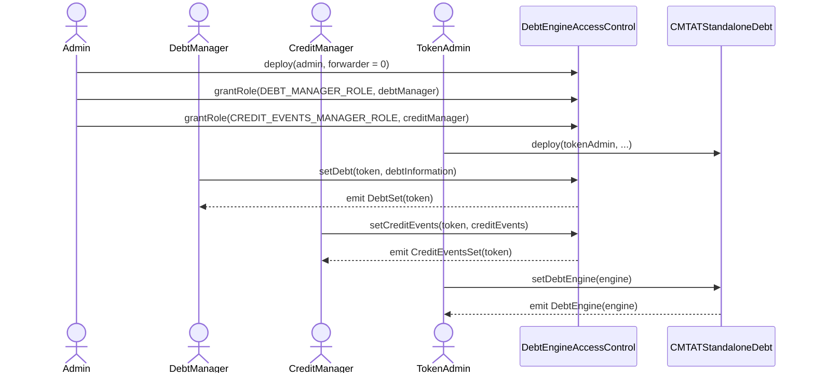
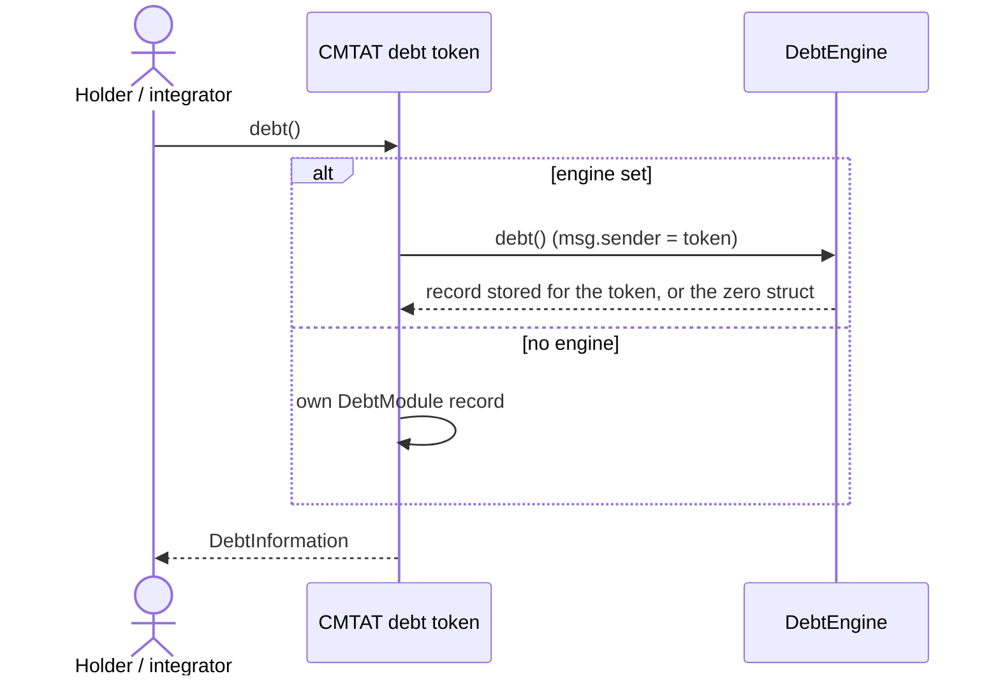

# Deploy a DebtEngine with a CMTAT v3.0.0 debt token

- [1. What the engine provides](#1-what-the-engine-provides)
- [2. Choose the setup](#2-choose-the-setup)
- [3. Contracts and roles](#3-contracts-and-roles)
- [4. Deployment steps](#4-deployment-steps)
  - [4.1 DebtEngineAccessControl with CMTATStandaloneDebt](#41-debtengineaccesscontrol-with-cmtatstandalonedebt)
  - [4.2 DebtEngineOwnable with CMTATStandaloneDebt](#42-debtengineownable-with-cmtatstandalonedebt)
  - [4.3 Upgradeable token behind a proxy](#43-upgradeable-token-behind-a-proxy)
- [5. One engine, several tokens](#5-one-engine-several-tokens)
- [6. Read workflow](#6-read-workflow)
- [7. Operating the engine](#7-operating-the-engine)
- [8. Handing over administration](#8-handing-over-administration)
- [9. Checks and troubleshooting](#9-checks-and-troubleshooting)

This guide deploys DebtEngine v0.3.0 next to a **CMTAT v3.0.0** debt token and connects them:

- **Where it sits:** one engine contract outside the token. The token's `debt()` and `creditEvents()` return what the engine stores for the token's address.
- **When it is connected:** always **after** the token is deployed. CMTAT v3.0.0 has no debt-engine constructor argument; the token is connected with `setDebtEngine(engine)`.
- **What changes for holders:** nothing on transfers or mints. The engine only serves data; it is not a compliance engine.

Every step below is executed by `test/DeployGuideCMTATv3.0.0.t.sol` against the CMTAT v3.0.0 submodule (`forge test --match-contract DeployGuideCMTATv300Test`). Each test is named after the section it validates. There is no deployment script in the repository yet; the calls are written in function-call notation, to be issued with your usual tooling (Foundry script, Safe transaction builder, `cast`).

## 1. What the engine provides

| Call on the token | With an engine set | Without an engine |
|---|---|---|
| `token.debt()` | `engine.debt()`, which returns the record stored under `msg.sender` = the token address | the token's own `DebtModule` record |
| `token.creditEvents()` | `engine.creditEvents()`, same rule | the token's own `DebtModule` record |
| `token.setDebt(...)`, `token.setCreditEvents(...)` | still write the token's own record, which is **not read** while an engine is set | write the token's own record |

- A record is keyed by the **token address**: for an upgradeable token, the proxy address.
- Every record is public: anyone can call `engine.debt(token)`, `engine.creditEvents(token)`, `engine.hasDebt(token)` and `engine.hasCreditEvents(token)`.
- `hasDebt(token)` is the only way to tell "no record" from "a record full of zeros"; `token.debt()` returns the zero struct in both cases.

## 2. Choose the setup

**Access-control variant (chosen at deployment, cannot be changed later):**

| Variant | Who writes records | Use it when |
|---|---|---|
| `DebtEngineAccessControl` | `DEBT_MANAGER_ROLE` for debt, `CREDIT_EVENTS_MANAGER_ROLE` for credit events; `DEFAULT_ADMIN_ROLE` implicitly holds both | Duties are separated (e.g. the issuer maintains the debt terms, a rating or servicing agent maintains credit events), or role holders must be listed on-chain (`getRoleMember`) |
| `DebtEngineOwnable` | The owner, for everything | One entity (often a multisig) maintains all data |

**Meta-transactions:**

| Forwarder | Effect |
|---|---|
| `address(0)` | Meta-transactions disabled. Recommended unless you need relayed admin transactions. |
| An ERC-2771 forwarder | Fixed for the engine's lifetime. The forwarder is trusted for **every** function, including role management and ownership transfer, so use one that verifies EIP-712 signatures (e.g. OpenZeppelin `ERC2771Forwarder`). Changing it means deploying a new engine. |

**Token type:** `CMTATStandaloneDebt` (deployed directly) or `CMTATUpgradeableDebt` (behind a proxy). Both include CMTAT's `DebtEngineModule`; other CMTAT deployment variants cannot be connected to an engine.

## 3. Contracts and roles

| Contract | Constructor | Key roles |
|---|---|---|
| `DebtEngineAccessControl` | `constructor(address admin, address forwarderIrrevocable)` | `DEFAULT_ADMIN_ROLE` (= `0x00`, granted to `admin`), `DEBT_MANAGER_ROLE = keccak256("DEBT_MANAGER_ROLE")`, `CREDIT_EVENTS_MANAGER_ROLE = keccak256("CREDIT_EVENTS_MANAGER_ROLE")` |
| `DebtEngineOwnable` | `constructor(address owner, address forwarderIrrevocable)` | owner (`Ownable2Step`) |
| `CMTATStandaloneDebt` (v3.0.0) | `constructor(address admin, ERC20Attributes, ExtraInformationAttributes, Engine)` | `DEBT_ROLE` connects the engine (`setDebtEngine`); CMTAT's `DEFAULT_ADMIN_ROLE` implicitly holds it |
| `CMTATUpgradeableDebt` (v3.0.0) | `constructor()` (disables initializers), then `initialize(admin, ERC20Attributes, ExtraInformationAttributes, Engine)` through the proxy | same as above |

Constructor parameters of the engine:

| Parameter | Type | Purpose | Checks |
|---|---|---|---|
| `admin` / `owner` | `address` | Initial administrator | Must not be `address(0)` (`AdminWithAddressZeroNotAllowed` / `OwnableInvalidOwner`) |
| `forwarderIrrevocable` | `address` | ERC-2771 trusted forwarder | None; `address(0)` disables meta-transactions; immutable |

Two separate permission sets are involved, and they are held by different contracts:

- **Engine side:** who may write records (the engine's roles or owner).
- **Token side:** who may connect or disconnect the engine (the token's `DEBT_ROLE`). An engine manager cannot call `setDebtEngine` on the token, and a token admin cannot write engine records unless also granted on the engine.

## 4. Deployment steps

The steps use one administrator for readability; in production the roles are usually held by separate accounts or multisigs.

**Order matters:** write the token's record in the engine **before** calling `setDebtEngine` on the token. From that call on, the token reads only the engine; if the engine has no record yet, `token.debt()` returns the zero struct, and any data written earlier with `token.setDebt(...)` is no longer visible (`testGuide_6_ConnectingBeforeWritingHidesLocalData`).

### 4.1 DebtEngineAccessControl with CMTATStandaloneDebt

Validated by `testGuide_4_1_AccessControlWithStandaloneToken`.

1. **Deploy the engine:** `DebtEngineAccessControl(admin, address(0))`. Check `engine.version() == "0.3.0"`.
2. **Grant the operational roles** (as `admin`):
   - `engine.grantRole(DEBT_MANAGER_ROLE, debtManager)`
   - `engine.grantRole(CREDIT_EVENTS_MANAGER_ROLE, creditManager)`
3. **Deploy the token:** `CMTATStandaloneDebt(tokenAdmin, erc20Attributes, extraInformationAttributes, engines)`.
4. **Write the token's records** in the engine:
   - as `debtManager`: `engine.setDebt(token, debtInformation)`
   - as `creditManager`: `engine.setCreditEvents(token, creditEvents)`
5. **Connect the token** (as a `DEBT_ROLE` holder of the token): `token.setDebtEngine(engine)`. The token emits `DebtEngine(engine)`.
6. **Verify:**
   - `token.debtEngine() == engine`
   - `engine.hasDebt(token) == true`, `engine.hasCreditEvents(token) == true`
   - `token.debt()` and `token.creditEvents()` return the records written in step 4.

### 4.2 DebtEngineOwnable with CMTATStandaloneDebt

Validated by `testGuide_4_2_OwnableWithStandaloneToken`.

1. **Deploy the engine** with the deployer as owner: `DebtEngineOwnable(deployer, address(0))`.
2. **Deploy the token** and **write its records** as the owner: `engine.setDebt(token, debtInformation)`, `engine.setCreditEvents(token, creditEvents)`.
3. **Hand ownership to the multisig** in two steps:
   - as the deployer: `engine.transferOwnership(multisig)` (nothing moves yet; `engine.pendingOwner() == multisig`)
   - as the multisig: `engine.acceptOwnership()`
4. **Connect the token:** `token.setDebtEngine(engine)`, then verify as in 4.1.

Notes:
- `transferOwnership(address(0))` does not renounce ownership; it cancels a pending transfer.
- `renounceOwnership()` leaves the engine without an owner and **freezes every record** permanently.

### 4.3 Upgradeable token behind a proxy

Validated by `testGuide_4_3_UpgradeableTokenThroughProxy`.

1. **Deploy the engine** (4.1 step 1, or 4.2 step 1).
2. **Deploy the token implementation:** `CMTATUpgradeableDebt()`.
3. **Deploy the proxy** with the initializer call, e.g. an ERC-1967 proxy: `ERC1967Proxy(implementation, initializeCalldata)`. `initialize` is overloaded in the CMTAT base contracts; encode the debt variant's signature explicitly: `initialize(address,(string,string,uint8),(string,(string,string,bytes32),string),(address,address,address))`.
4. **Write the records under the proxy address**: `engine.setDebt(proxy, debtInformation)`. Holders and integrators call the proxy, so the engine sees the proxy as `msg.sender`; a record stored under the implementation address is never read.
5. **Connect** through the proxy: `CMTATUpgradeableDebt(proxy).setDebtEngine(engine)`, then verify.

An upgrade of the token implementation keeps the proxy address, so the engine record stays valid.

## 5. One engine, several tokens

Validated by `testGuide_5_OneEngineSeveralTokens`.

One engine can serve any number of tokens; each token reads its own record.

1. Write all records in one call: `engine.setDebtBatch([tokenA, tokenB], [debtA, debtB])` (and `setCreditEventsBatch` for credit events).
2. Connect each token: `tokenA.setDebtEngine(engine)`, `tokenB.setDebtEngine(engine)`.

Batch limits:
- The arrays must have the same length (`InvalidInputLength`), and contain at most `MAX_BATCH_SIZE` = 500 entries (`BatchSizeTooLarge`).
- In practice the transaction gas limit binds first. In the test suite a debt record with typical strings costs about 400k gas and a short credit-events record about 71k; under the Ethereum mainnet cap of 16,777,216 gas per transaction (EIP-7825), a batch holds roughly 40 debt records or 230 credit-events records. Estimate gas for your own data.
- A duplicated address keeps the last record and emits one event per entry.

## 6. Read workflow

- `token.creditEvents()` follows the same path.
- An integrator that needs to know whether a record exists calls `engine.hasDebt(token)` / `engine.hasCreditEvents(token)` directly.

## 7. Operating the engine

Validated by `testGuide_7_Operations` and `testGuide_7_RolesAreSeparated`.

| Task | Call | Caller (`DebtEngineAccessControl`) | Caller (`DebtEngineOwnable`) | Effect on the token |
|---|---|---|---|---|
| Update the debt terms | `engine.setDebt(token, debtInformation)` | `DEBT_MANAGER_ROLE` | owner | Visible immediately |
| Record a credit event (default, redemption, rating change) | `engine.setCreditEvents(token, creditEvents)` | `CREDIT_EVENTS_MANAGER_ROLE` | owner | Visible immediately |
| Update many tokens | `setDebtBatch` / `setCreditEventsBatch` | as above | owner | Visible immediately |
| Delete a record | `engine.clearDebt(token)` / `engine.clearCreditEvents(token)` | as above | owner | Token returns the zero struct; `hasDebt` becomes false |
| Replace the engine | `token.setDebtEngine(newEngine)` | token `DEBT_ROLE` | token `DEBT_ROLE` | Token reads the new engine; write the record there first |
| Disconnect the engine | `token.setDebtEngine(address(0))` | token `DEBT_ROLE` | token `DEBT_ROLE` | Token falls back to its own `DebtModule` data |
| Grant / revoke a manager | `engine.grantRole` / `engine.revokeRole` | `DEFAULT_ADMIN_ROLE` | — | None |

Notes:
- Setting the engine the token already uses reverts on the token side with `CMTAT_DebtEngineModule_SameValue`.
- A debt manager cannot write credit events and vice versa; neither can connect a token, which needs the token's own `DEBT_ROLE`.
- Clearing a record that does not exist succeeds and still emits `DebtCleared` / `CreditEventsCleared`.

## 8. Handing over administration

Validated by `testGuide_8_AdminHandoverRunbook`.

`DebtEngineAccessControl` treats `DEFAULT_ADMIN_ROLE` as holding every role. As a side effect, granting a manager role to an account that is already admin is a silent no-op, and revoking one from it emits `RoleRevoked` while the account keeps the power. To move administration from a deployer key to a multisig while the deployer stays a debt manager, use this order:

1. as the deployer: `engine.grantRole(DEFAULT_ADMIN_ROLE, multisig)`
2. as the deployer: `engine.renounceRole(DEFAULT_ADMIN_ROLE, deployer)`
3. as the multisig: `engine.grantRole(DEBT_MANAGER_ROLE, deployer)`

Granting the manager role in step 1, before renouncing, would be lost at step 2. If the last `DEFAULT_ADMIN_ROLE` holder renounces, roles can no longer be granted or revoked.

For `DebtEngineOwnable`, use the two-step transfer of section 4.2.

## 9. Checks and troubleshooting

After deployment:

| Check | Expected |
|---|---|
| `engine.version()` | `"0.3.0"` |
| `token.debtEngine()` | the engine address |
| `engine.hasDebt(token)` / `engine.hasCreditEvents(token)` | `true` for every record written |
| `token.debt()` / `token.creditEvents()` | the records written in the engine |
| `engine.getRoleMemberCount(DEBT_MANAGER_ROLE)` (RBAC) | the managers granted (the admin is not listed) |
| `engine.owner()` (Ownable) | the final owner; `pendingOwner()` is `address(0)` |
| `engine.isTrustedForwarder(x)` | `true` only for the forwarder chosen at deployment |

| Symptom / error | Cause | Fix |
|---|---|---|
| `token.debt()` returns zeros | The engine has no record for this token address (wrong address, the implementation instead of the proxy, record cleared), or the token was connected before the record was written | Check `engine.hasDebt(token)`; write the record under the proxy / token address |
| `AccessControlUnauthorizedAccount(account, role)` on the engine | The caller lacks `DEBT_MANAGER_ROLE` / `CREDIT_EVENTS_MANAGER_ROLE` | Grant the role from a `DEFAULT_ADMIN_ROLE` holder |
| `AccessControlUnauthorizedAccount(account, DEBT_ROLE)` on the token | `setDebtEngine` called by an account without the token's `DEBT_ROLE` | Call it from the token admin or a `DEBT_ROLE` holder |
| `OwnableUnauthorizedAccount(account)` | Not the owner, or ownership not yet accepted | Call from the owner; `acceptOwnership()` from the pending owner |
| `SmartContractWithAddressZeroNotAllowed()` | A record for `address(0)` | Pass the token address |
| `InvalidInputLength()` / `BatchSizeTooLarge(size, 500)` | Batch arrays of different lengths / too many entries | Fix the arrays; split the batch |
| `CMTAT_DebtEngineModule_SameValue()` | `setDebtEngine` with the engine already set | Nothing to do |
| A manager role granted to the admin does not appear in `getRoleMember` | Implicit admin membership (section 8) | Grant it after the account stops being admin |

See also: the README sections *Access Control*, *Gasless support (ERC-2771)* and *Compatibility*, and the security review in `doc/tools/v0.3.0/CLAUDE_AUDIT.md`.
